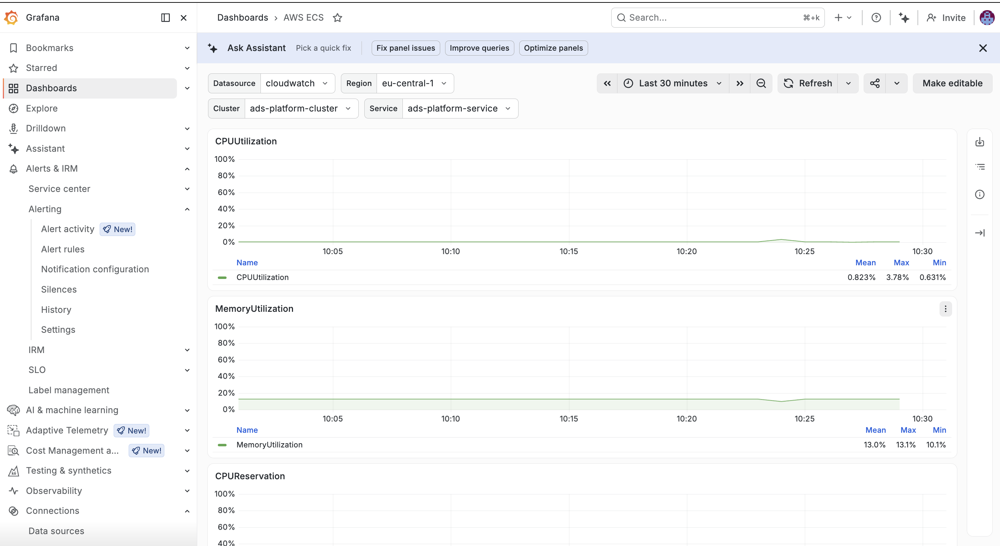
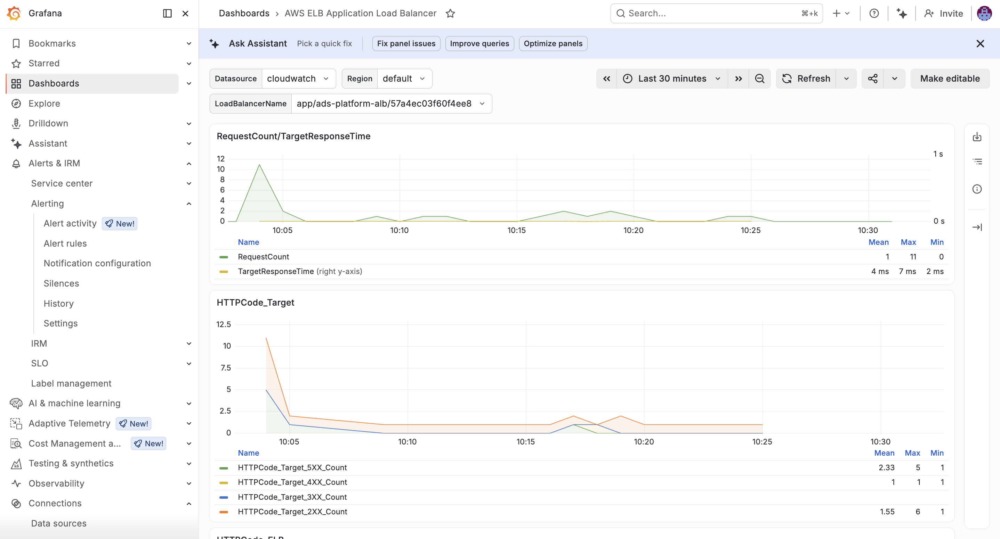
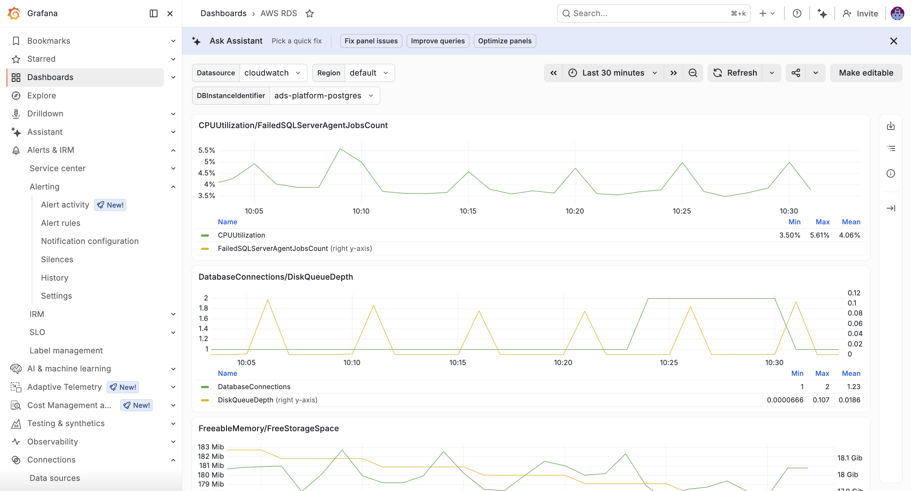
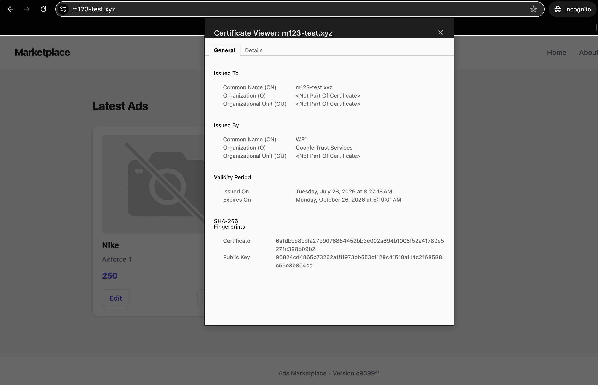
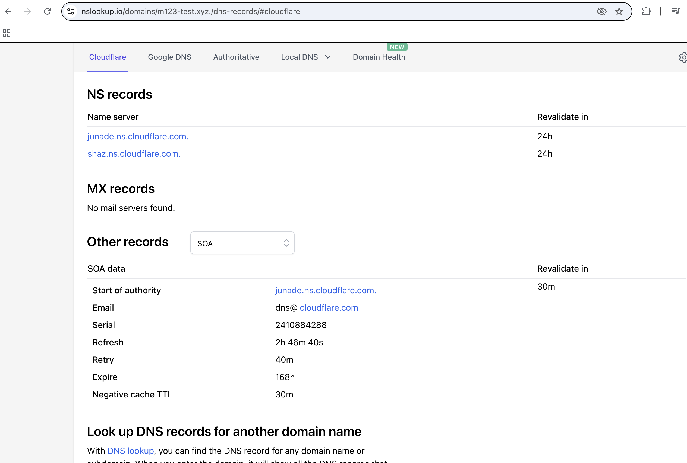
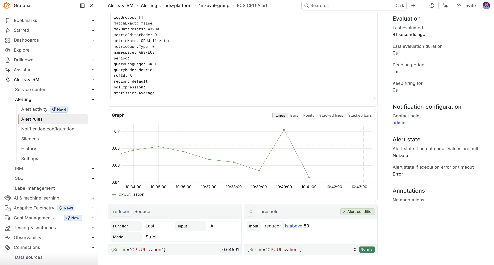
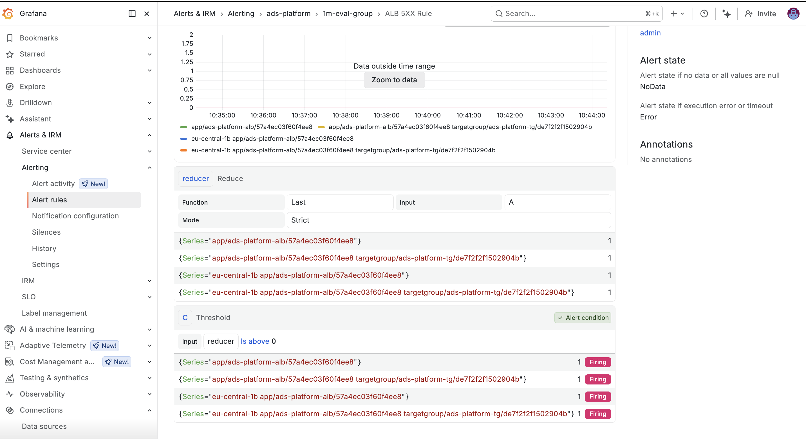
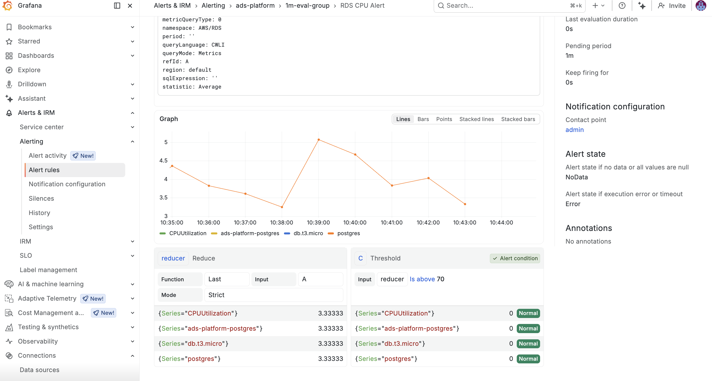
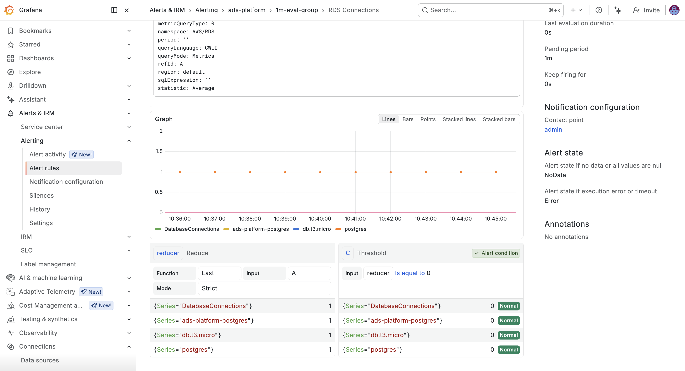

# Ads Platform

A minimal FastAPI classifieds app used as a vehicle to build and operate real
AWS infrastructure end to end — VPC, ECS Fargate, an Application Load
Balancer, RDS, CI/CD, Cloudflare, and Grafana/CloudWatch monitoring. The app
itself is intentionally simple (CRUD for ad listings); the focus of this
project is everything around it: **Infrastructure as Code, deployment
automation, observability, and production hardening.**

## Architecture

```
                         Internet
                            │
                      ┌─────▼─────-┐
                      │ Cloudflare │  DNS, CDN, TLS (edge)
                      └─────┬─────-┘
                            │ HTTPS
                 ┌──────────▼──────────-┐
                 │   AWS VPC (public)   │
                 │  ┌────────────────┐  │
                 │  │  ALB (:443)    │  │  ACM cert, HTTP→HTTPS redirect
                 │  └───────┬────────┘  │
                 │          │           │
                 │  ┌───────▼────────┐  │
                 │  │ ECS Fargate    │  │  FastAPI container (:8000)
                 │  │ (ads-platform) │  │
                 │  └───────┬────────┘  │
                 └──────────┼───────────┘
                            │
                 ┌──────────▼───────────┐
                 │   AWS VPC (private)  │
                 │  ┌────────────────┐  │
                 │  │  RDS Postgres  │  │
                 │  └────────────────┘  │
                 └──────────────────────┘

     CloudWatch Logs/Metrics ──► Grafana (read-only IAM user)
```

- **Networking** — custom VPC with public subnets (ALB, Fargate tasks) and
  private subnets (RDS), internet gateway, route tables, and
  least-privilege security groups.
- **Compute** — containerized FastAPI app running on ECS Fargate, fronted by
  an Application Load Balancer with an ACM-issued TLS certificate.
- **Data** — PostgreSQL on RDS in a private subnet, only reachable from the
  application security group.
- **CI/CD** — GitHub Actions builds and pushes a Docker image to ECR, then
  registers a new ECS task definition revision and rolls it out with
  `--force-new-deployment` on every push to `main`.
- **Edge / Security** — Cloudflare sits in front of the ALB for DNS, CDN,
  and HTTPS, with production-hardening headers applied at the app layer.
- **Observability** — ECS and ALB logs/metrics flow to CloudWatch; Grafana
  connects with a scoped, read-only IAM user to visualize RDS, ECS, and ALB
  dashboards, with alert rules on ECS CPU, ALB 5XX rate, RDS CPU, and RDS
  connection count.

## Screenshots

| ECS Dashboard | ALB Dashboard |
| --- | --- |
|  |  |

| RDS Dashboard | HTTPS Certificate |
| --- | --- |
|  |  |



### Alerting

| ECS CPU Alert | ALB 5XX Alert |
| --- | --- |
|  |  |

| RDS CPU Alert | RDS Connections Alert |
| --- | --- |
|  |  |

## Tech stack

**App:** Python, FastAPI, SQLAlchemy, Jinja2, SQLite (local) / PostgreSQL (production)
**Infra:** Terraform, AWS (VPC, ECS Fargate, ALB, RDS, ECR, IAM, CloudWatch), Docker, Cloudflare
**Delivery:** GitHub Actions, Amazon ECR, rolling ECS deployments
**Observability:** CloudWatch, Grafana

## Running locally

```bash
python -m venv .venv && source .venv/bin/activate
pip install -r requirements.txt
cp .env.example .env
python run.py
```

The app is served at `http://localhost:8000` using a local SQLite database.

## Deploying the infrastructure

```bash
cd terraform/aws
terraform init
terraform apply -var="db_password=<password>" -var="domain_name=<your-domain>"
```

Pushing to `main` triggers [`.github/workflows/deploy.yml`](.github/workflows/deploy.yml),
which builds the image, pushes it to ECR, and rolls out a new ECS task
definition revision.

## What this project demonstrates

- Designing a VPC from scratch (subnets, route tables, gateways, security groups)
- Running containerized workloads on ECS Fargate behind an ALB
- Managing a private RDS instance with least-privilege network access
- Automating builds and rolling deployments with GitHub Actions
- Provisioning AWS resources with Terraform, including ACM cert validation
- Setting up scoped IAM access for third-party monitoring (Grafana)
- Hardening a production endpoint with Cloudflare
